# Application Flow

This document describes application execution flows. Business rules, the state machine, and the access matrix are defined in `PRD.md` §5, §8, §9.

## Architecture

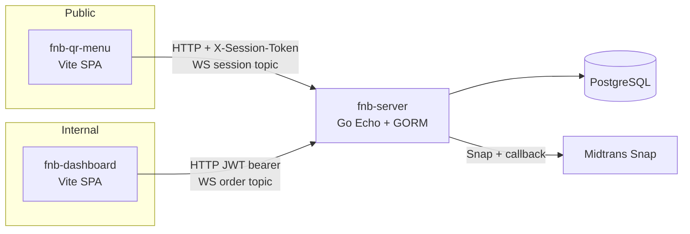

- QR Menu without login; identified by a table session token.
- Dashboard uses JWT and role `OWNER`, `CASHIER`, `KITCHEN`.
- Real time over one WebSocket hub; polling every 3–5 seconds (dashboard) and 5 seconds (QR Menu) is the fallback when the socket drops.

## Dine-in order end-to-end

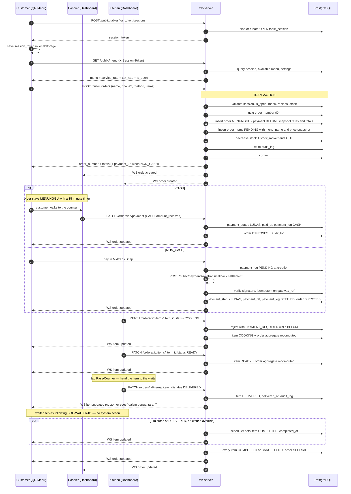

## Take away order (cashier)

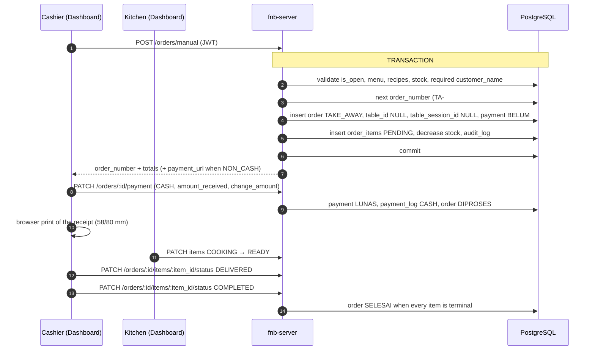

Manual orders have no table and no table session. Payment, item transitions, stock, and cancellation behave exactly like dine-in orders, except that the cashier owns `READY → DELIVERED → COMPLETED`.

## Table session lifecycle

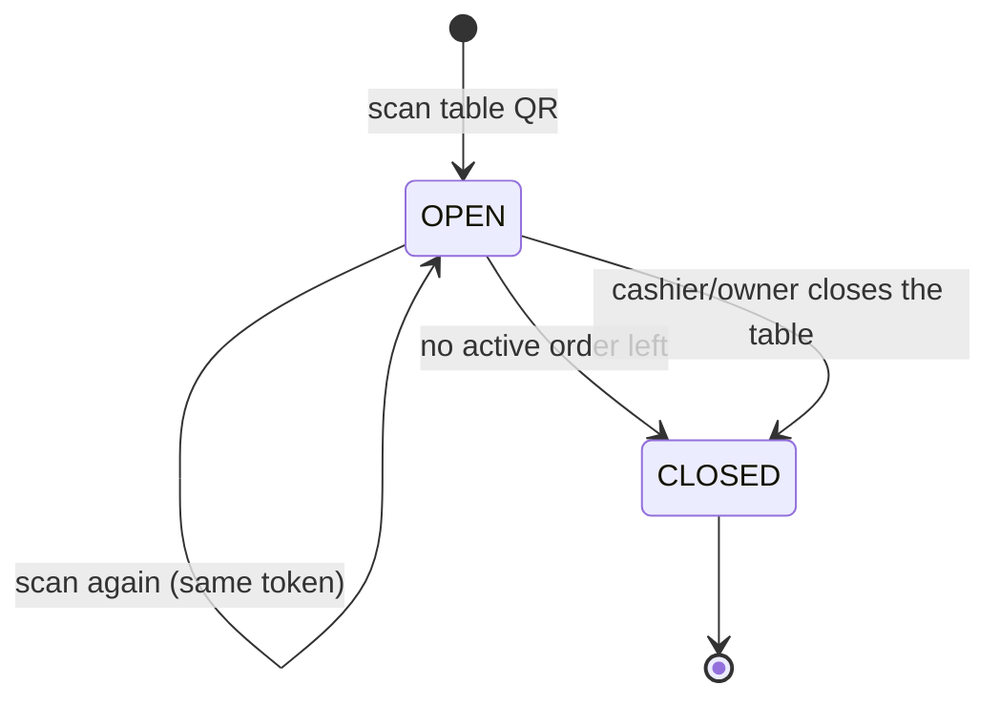

- A session closes automatically when it holds no order other than `SELESAI` or `DIBATALKAN`.
- Closing never deletes orders; `orders.table_session_id` keeps the history.
- A closed session cannot be reopened; the next scan creates a new one (EC-04).

## Order cancellation (unpaid only)

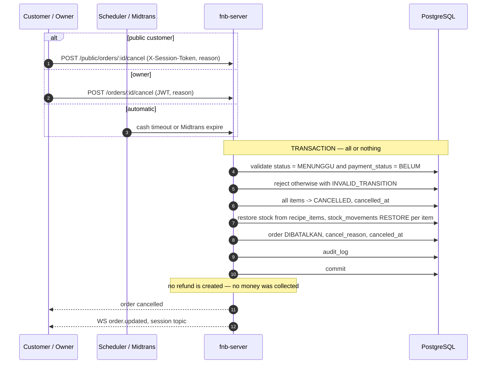

Allowed while the store is closed. A paid order (`DIPROSES`) cannot be cancelled in v1; the owner handles it manually (BR-06).

## Stock

Stock decreases when an order is created and is restored when the order is cancelled.

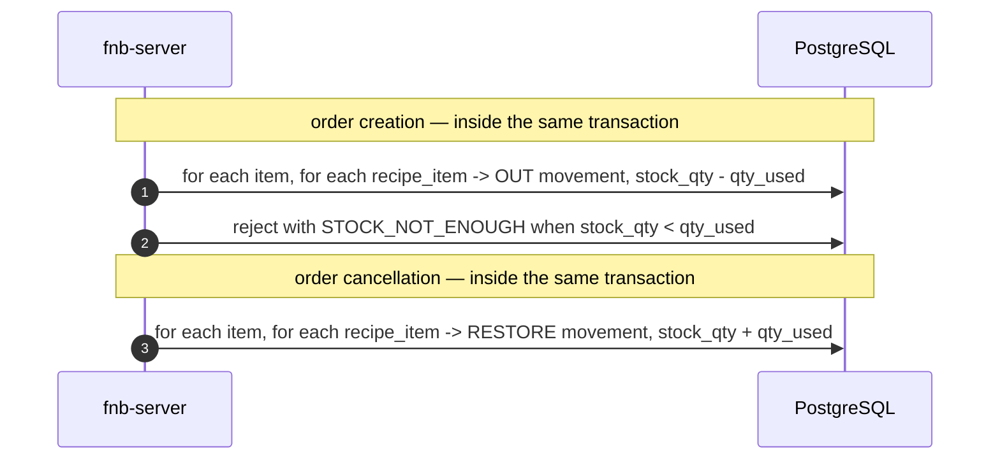

The movement log is append-only.

## Stock Opname

Physical stock correction. A correction is recorded as a new `ADJUSTMENT`, never an edit or delete.

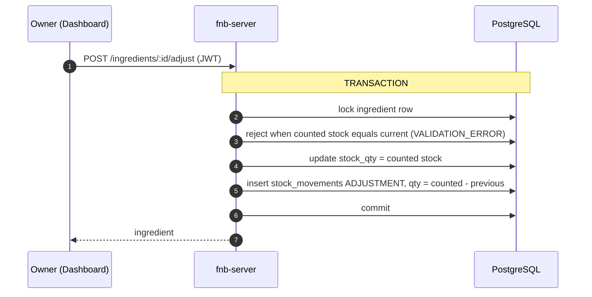

## Recipe Management

PRD BR-23: recipes are finalized before the store opens, so editing is rejected while `settings.is_open` is true. Reading recipes stays allowed.

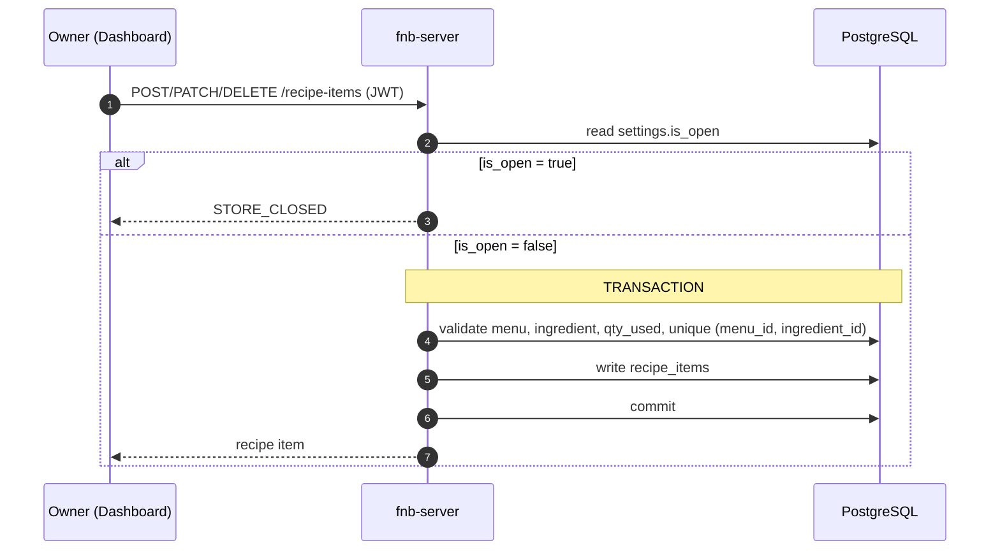

## Midtrans callback

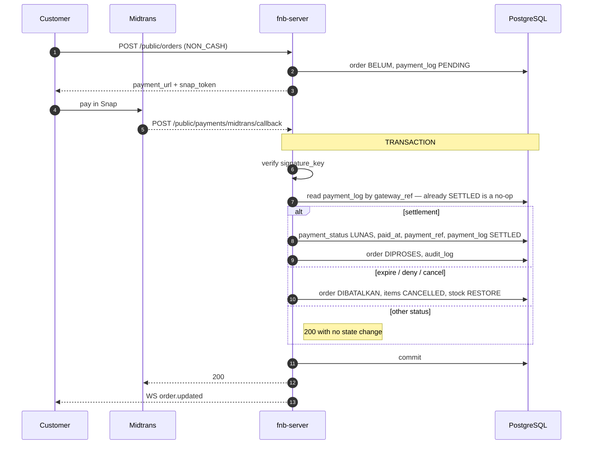

A replayed callback returns `200` and writes nothing (BR-16).

## Scheduled jobs

One loop runs every minute and is safe to repeat.

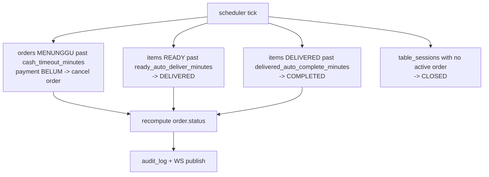

The kitchen sees a warning `ready_auto_deliver_warning_minutes` before the auto-deliver fires.

## Real time and polling

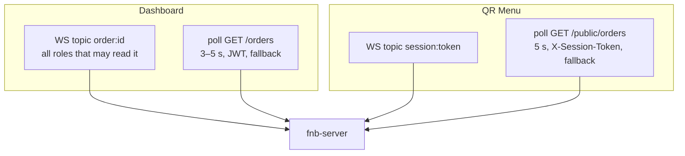

The server is the only publisher. If the socket drops, the client polls until it reconnects (EC-19).

## Request layers

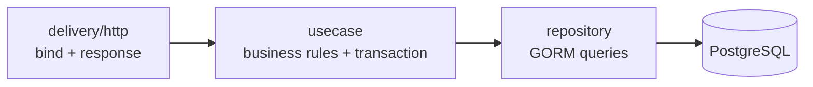

- Handler: bind, validate, call usecase, send response envelope.
- Usecase: role checks, status transitions, calculations, audit writes, and the steps executed inside a transaction.
- Repository: opens/commits transactions and runs database queries, without business decisions.

Transaction ownership is hybrid: the repository exposes `database.WithTx` (GORM mechanics), the usecase declares the transaction-scoped interface and decides the sequence of writes.
