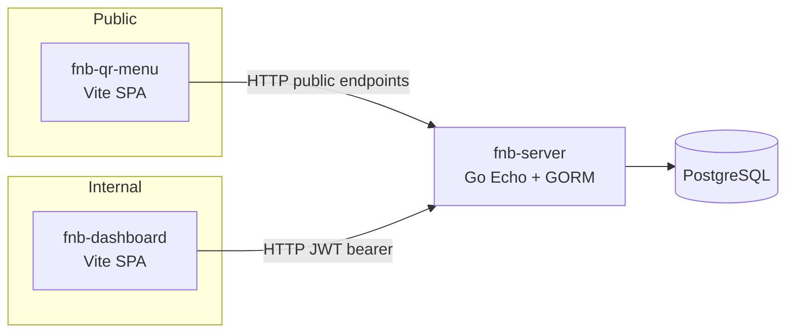
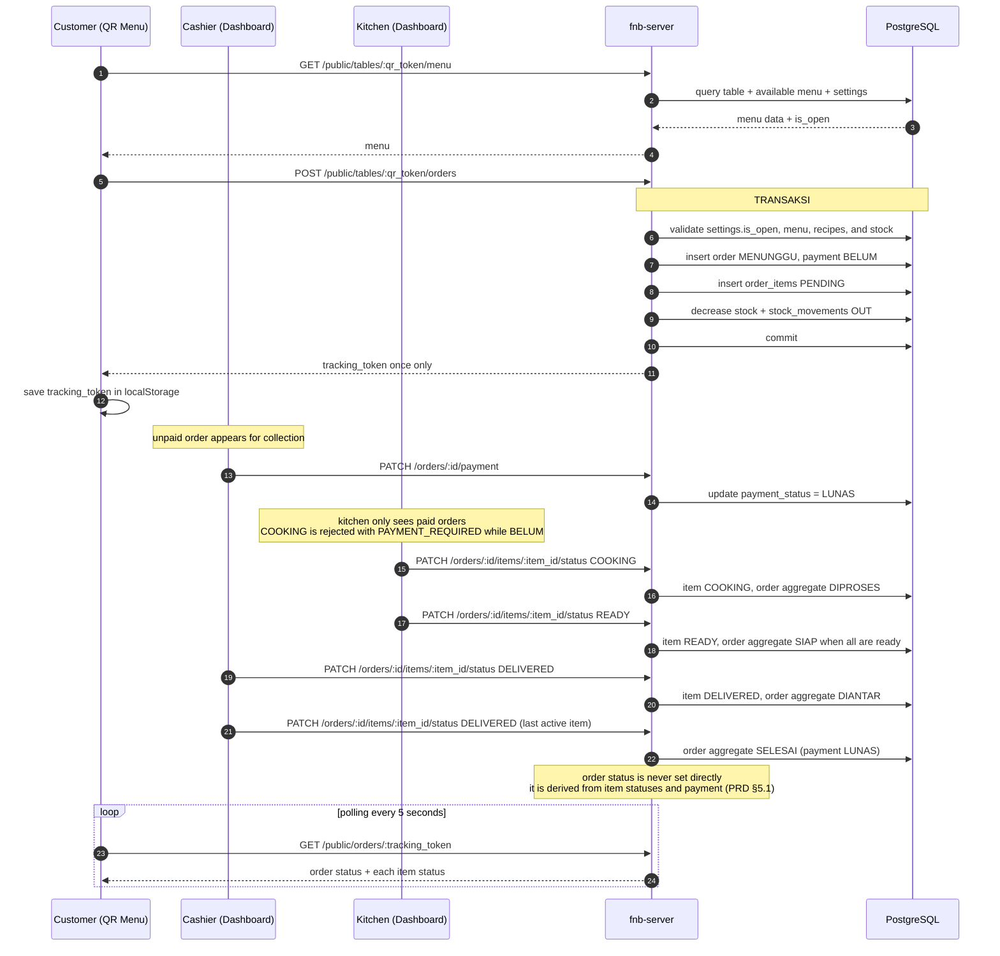
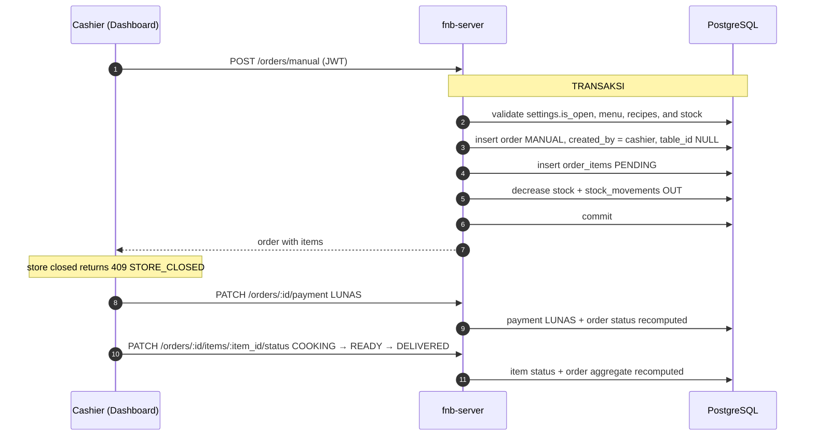
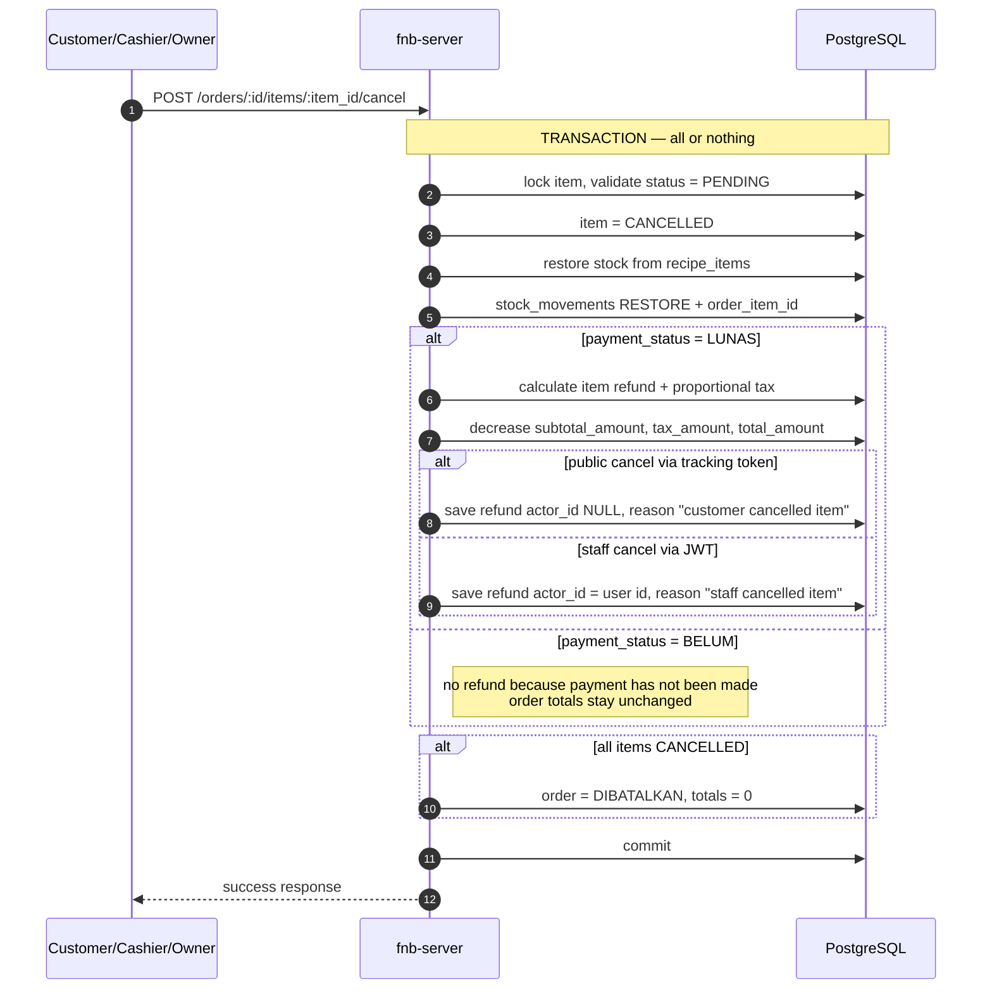
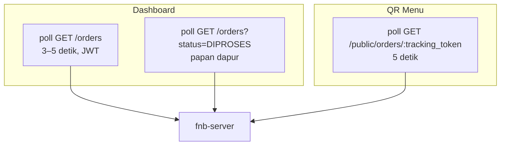
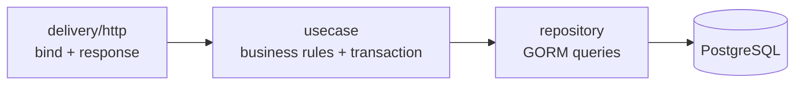

# Application Flow

This document describes application execution flows. Role and status matrices are defined in `docs/PRD.md` §5.

## Architecture

- QR Menu without login; uses table token and tracking token.
- Dashboard uses JWT and role `OWNER`, `CASHIER`, `KITCHEN`.
- MVP uses polling: dashboard 3–5 detik, QR Menu 5 detik.

## Order QR end-to-end

## Manual order

Manual orders have no table and no tracking token. Payment, item transitions, stock, and cancellation behave exactly like QR orders.

## Atomic Item Cancellation and Refund

## Polling

## Request Layers

- Handler: bind, validate, call usecase, send response envelope.
- Usecase: role checks, status transitions, calculations, and the steps executed inside a transaction.
- Repository: opens/commits transactions and runs database queries, without business decisions.

Transaction ownership is hybrid: the repository exposes `database.WithTx` (GORM mechanics), the usecase declares the transaction-scoped interface and decides the sequence of writes.
