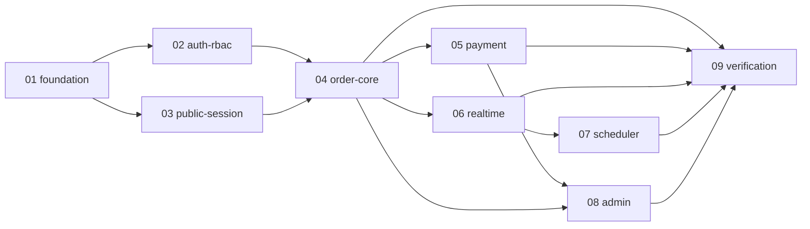

# Implementation Plans — fnb-server

Server implementation plan derived from `../../../docs/PRD.md`, `../../../docs/flow.md`, `../../../docs/api.md`, and the existing codebase.

This directory replaces the previous per-slice `docs/plan-*.md` files.

## Sources of truth

| Document | Owns |
|---|---|
| `../../../docs/PRD.md` | business rules, state machine, data model, access matrix |
| `../../../docs/flow.md` | execution flows, transaction boundaries, request layers |
| `../../../docs/api.md` | endpoint contracts, request/response shape, error codes |
| `docs/rules.md`, `docs/structure.md` | layering, naming, DTO, wiring rules |
| `docs/tech-stack.md` | approved dependencies |

If a plan and those documents disagree, the documents win. Fix the plan, then the code.

## Baseline: migration-aware

The repository already ships auth, admin CRUD, stock, users, settings, and a partial order flow. This plan adapts that code to the PRD instead of rewriting it.

Already done and kept:

- `POST /auth/login|refresh|logout`, JWT access token, refresh cookie, `sessions` table with token hash.
- `RequireRoles` middleware, role enum `OWNER`/`CASHIER`/`KITCHEN`.
- Menu, category, table, ingredient, recipe, user, settings CRUD.
- Stock movement append-only model, restock endpoint.
- Order creation with price snapshot, stock `OUT` movements, item status transitions, aggregate order status.
- Response envelope, binder, error handler, request logger, rate limiter.

Diverges from the PRD and must change (owned by the plans below):

| Gap | Plan |
|---|---|
| No `table_sessions`, customer identified by `tracking_token_hash` | 01, 03 |
| `order_type` = `QR`/`MANUAL`; PRD wants `DINE_IN`/`TAKE_AWAY` | 01 |
| No `order_number`, no `order_sequence` | 01, 04 |
| No service charge; only `tax_percent` | 01, 04 |
| No `customer_name`/`customer_phone` | 01, 04 |
| Item-level cancel with `refunds`; PRD has order-level cancel and no refund | 01, 04 |
| `order_status` enum carried unused `SIAP`/`DIANTAR` | 01 |
| No `payment_log`, `audit_log`, `paid_at`, `payment_ref`, `amount_received` | 01, 04, 05 |

## Milestones

| # | File | Outcome | Status |
|---|---|---|---|
| 01 | `plan-01-foundation.md` | Migration `000003` aligns schema with PRD §10; domain enums and pure functions ready | DONE |
| 02 | `plan-02-auth-rbac.md` | Login, refresh, role guard, owner seed verified against PRD §3/§9 | DONE |
| 03 | `plan-03-public-session.md` | Table session open, `X-Session-Token`, public menu | DONE |
| 04 | `plan-04-order-core.md` | Create order (QR + manual), totals, order number, item transitions, order-level cancel | DONE |
| 05 | `plan-05-payment.md` | Cash confirmation, `payment_log`, Midtrans Snap and callback | DONE |
| 06 | `plan-06-realtime.md` | WebSocket hub, topics, publish after commit | DONE |
| 07 | `plan-07-scheduler.md` | Auto-cancel, auto-deliver, auto-complete, session close | DONE |
| 08 | `plan-08-admin.md` | Remaining CRUD aligned with PRD, session endpoints, audit log | DONE |
| 09 | `plan-09-verification.md` | Tests, Bruno collection, doc sync, commit gate | DONE |

Each milestone ends in a state where `go test ./... && go build ./...` passes and the API matches `../../../docs/api.md` for the endpoints it owns.

## Plan format

Every plan uses the same sections:

1. **Scope** — endpoints or packages touched, and what stays out.
2. **Decisions** — numbered, each with the reason or the PRD clause it enforces.
3. **Schema / domain contracts** — migrations, typed enums, interfaces, pure functions.
4. **Repository** — query and transaction methods.
5. **Usecase** — business rules and the order of writes inside a transaction.
6. **Delivery** — routes, middleware, DTOs.
7. **Tests** — the focused tests required by `docs/rules.md`.
8. **Verification** — commands and manual checks.
9. **Docs to update** — documents that change with the code.

## Cross-cutting rules

- Dependency direction stays `delivery → usecase → repository → domain` (`docs/structure.md`).
- Every new Echo route is registered in `internal/delivery/http/router.go`; per-feature wiring in `cmd/api/wiring.go` (split into `wiring_<feature>.go` past ~150 lines).
- Business rules live in usecases. Handlers bind, validate shape, call the usecase, and map to DTOs.
- Every write that touches more than one table runs in one GORM transaction owned by the usecase (`database.WithTx`).
- Money is `int64` rupiah. Rates are `numeric`/`float64` and always snapshotted into the order.
- Every status change writes `audit_log`.
- No new dependency without a line in `docs/tech-stack.md`.

## Definition of done

- Schema matches PRD §10 exactly, verified by reading `migrations/000001` + `000002` + `000003` in sequence.
- Every endpoint in `../../../docs/api.md` exists with the documented role, body, response, and error code.
- State machine in `../../../docs/flow.md` is enforced by `domain.ValidateItemTransition` and `domain.AggregateOrderStatus`, not by handler conditionals.
- `go test ./... && go build ./...` pass; `go test -race ./...` passes for order and scheduler packages.
- No `.env`, `bin/`, credential, or token file staged.
- `docs/` updated in the same commit as the behavior it describes.
